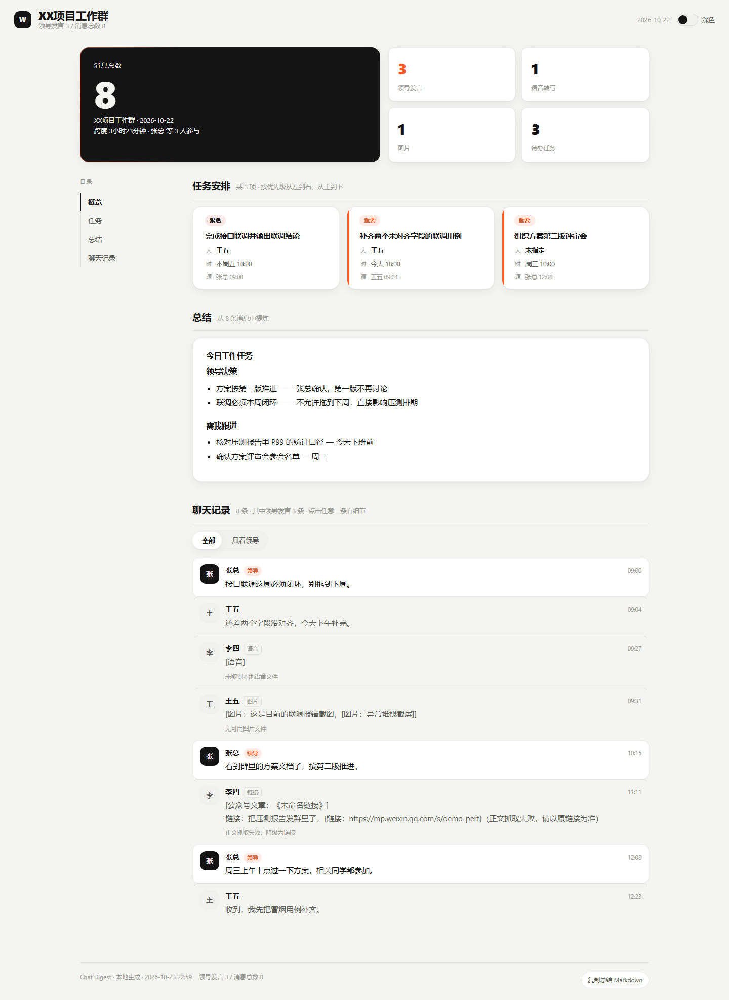

# Chat Digest


本地优先的微信群聊多模态 AI 工作助手：**把群里一天的聊天，整理成一份能直接执行的工作报告。**

语音转文字、图片理解、公众号正文抓取 → 合并成上下文 → 交给大模型抽取任务与决策 → 输出 Markdown + 可交互 HTML 报告。

> **数据默认不出本机。** 不配 API Key 时自动回落为离线模式，只生成待处理文件，不发起任何网络请求。



<sub>截图使用 `tools/demo_seed.py` 生成的合成数据，不含任何真实聊天记录。</sub>

---

## 它解决什么

| 痛点 | 这个项目怎么做 |
| --- | --- |
| 领导在群里发语音布置任务，事后找不到 | 语音自动转文字，进文本流 |
| 群里刷了 300 条，分不清哪条有料 | 按「领导名单」打 `[领导]` 标记，可切换「只看重点」 |
| 截图 / 报表里的信息抓不住 | 图片生成一句话描述，和文字一起进上下文 |
| 转发的公众号文章懒得点开 | 自动抓正文，失败降级为「链接 + 标题」 |
| 总结时还要手动复制粘贴 | 一键生成带完整提示词的待处理文件，或直连在线模型 |

---

## 30 秒看效果（不需要微信，不需要 API Key）

```bash
git clone <this-repo> && cd chat-digest
python -m pip install -e .

# 用合成数据跑一遍完整链路，产出 4 份报告
python tools/demo_seed.py --sample-summary

# 打开任意一份看效果（Windows）
start runs\2026-10-22_XX项目工作群.html
```

`--sample-summary` 会塞一份**手写的示例总结**，好让任务卡片、领导决策这些渲染效果都能看到；不加这个参数则走真实的离线 `file_output` 模式。

---

## 快速开始

### 1. 环境

- Python **3.10+**
- Windows（启动脚本是 `.bat`，核心代码跨平台）

```bash
python -m pip install -e .            # 核心依赖：requests / PyYAML / beautifulsoup4
python -m pip install -e ".[asr]"     # 可选：语音转写（faster-whisper，首次会下载模型）
```

### 2. 接上数据源

本项目只负责「读一个本地的消息库」，**不负责生产数据**。目前支持两种后端，配置在 `config/settings.yaml`：

| 后端 | 触发条件 | 说明 |
| --- | --- | --- |
| SQLite 直读 | `.env` 里 `WX_DECRYPTED_DIR` 指向一个有效的解密库目录 | 推荐。直接读表，不依赖常驻服务 |
| chatlog HTTP | 上面没配，或目录无效 | 兼容旧方案，需要本地跑一个 chatlog 服务 |

```bash
cp .env.example .env         # 然后编辑
# WX_DECRYPTED_DIR=C:/path/to/your/decrypted/sqlite/dir
```

> 数据源怎么来（导出工具、解密方式）由你自己决定，仓库不提供这部分。请确保你处理的是**自己合法拥有**的数据。

### 3. 跑一次

```bash
python main.py --list-groups                    # 看看有哪些群
python main.py --group "XX项目工作群" --format both --open
```

产物落在 `runs/`：

```
runs/
├── 2026-10-22_XX项目工作群.md      # Markdown 报告
├── 2026-10-22_XX项目工作群.html    # HTML 报告（双击就能看）
└── pending/
    └── 20261022_143000_content.md  # 待处理内容（交给外部 AI 用）
```

### 4. 或打开可视化控制台

```bash
python main.py --serve       # 或双击 启动.bat
```

浏览器打开 `http://127.0.0.1:5710`：选群、选日期、点按钮生成、翻阅历史报告。

> 控制台用 Python 标准库 `http.server` 实现，**零额外 Web 依赖**，只监听 `127.0.0.1`。

---

## 命令行参数

| 参数 | 说明 |
| --- | --- |
| `--group / -g` | 目标群名（必须与数据源里的群名一致） |
| `--date / -d` | `2026-10-22` / `today` / `yesterday`，默认今天 |
| `--leaders-only` | 只让领导发言进入总结 |
| `--model` | `default`（跟随配置）/ `deepseek` / `doubao` / `file_output` |
| `--template` | prompt 模板名，对应 `config/prompts/*.md` |
| `--format / -f` | `markdown`（默认）/ `html` / `both` / `none` |
| `--no-chat` | 报告里不附带聊天记录全文 |
| `--dry-run` | 跑完链路但不落盘 |
| `--open` | 生成后自动打开 HTML 报告 |
| `--list-groups` | 列出数据源里的全部群聊 |
| `--serve` | 启动本地控制台 |
| `--no-progress` / `--verbose` | 关闭进度条 / DEBUG 日志 |

---

## 配置

### `config/groups.yaml`

```yaml
target_groups:
  - name: "XX项目工作群"
    enabled: true
    leaders:
      - name: "张总"
        id: "wxid_xxxx"
global_leaders:              # 跨群都要关注的老板放这里
  - name: "陈总"
    id: ""
```

命中规则：`id` 与 `name` 任一匹配即算命中，`id` 优先。

> 这个文件会进 git，提交前请把真实群名 / 昵称 / wxid 换成占位符。

### `config/settings.yaml`

全部参数都有默认值，缺任何一个 key 都不会崩：

| 区块 | 关键项 |
| --- | --- |
| `chatlog` | `api_base` / `decrypted_dir` / `timeout` / `page_size` / `max_pages` |
| `asr` | `enabled` / `model` / `device` / `compute_type` / `language` |
| `vision` | `provider`（`dummy` / `doubao`）/ `model` / `max_images` |
| `article` | `enabled` / `timeout` / `max_chars` / `retry` |
| `summarizer` | `provider`（`deepseek` / `file_output` / `doubao`）/ `prompt_template` / `model` |
| `output` | `dir` / `format` / `html_theme` |
| `web` | `enabled` / `host` / `port` / `open_browser` |

密钥走 `.env`（复制 `.env.example` 改名即可）：

```bash
DEEPSEEK_API_KEY=sk-...
DEEPSEEK_BASE_URL=https://api.deepseek.com
```

**没配密钥也不会报错** —— 默认的 `deepseek` 模式检测到缺 Key 后会自动回落到离线 `file_output`。

---

## 界面

- **HTML 报告**：吸顶目录联动、主数字块、任务卡片、聊天流错峰入场、深色模式、点击卡片展开详情。
- **本地控制台**：按钮变进度条、滑动确认删除、骨架屏、Toast 堆叠、日期日历。
- 动效统一 200–420ms、spring 曲线，并完整支持 `prefers-reduced-motion`。

自测方式：`python tools/demo_seed.py --sample-summary` 生成 4 份报告，覆盖群聊、语音、图片、链接四种消息类型。

---

## 目录结构

```
chat-digest/
├── main.py                  # CLI 入口
├── pyproject.toml
├── config/
│   ├── settings.yaml        # 所有可变参数
│   ├── groups.yaml          # 目标群 + 领导名单
│   └── prompts/             # leader_brief / daily_digest / todo_list
├── collector/
│   ├── models.py            # 统一消息数据结构 Message
│   ├── sqlite_client.py     # 直读解密后的 SQLite
│   └── chatlog_client.py    # chatlog HTTP 客户端（兼容保留）
├── processor/
│   ├── voice_asr.py         # faster-whisper 语音转写
│   ├── image_vision.py      # 图片理解（VisionProvider 抽象 + 豆包 + dummy）
│   ├── article_fetch.py     # 公众号正文抓取
│   └── merge.py             # 消息合并成文本流
├── summarizer/
│   ├── base.py              # Summarizer 抽象基类
│   ├── file_output.py       # 离线模式：生成待处理文件
│   └── doubao_api.py        # 在线模式：OpenAI 兼容接口（DeepSeek / 豆包 / 通义…）
├── output/
│   ├── markdown.py          # Markdown 报告
│   ├── html.py              # HTML 报告
│   └── md_lite.py           # 极简 Markdown 渲染器
├── web/
│   ├── server.py            # 本地控制台后端（标准库实现）
│   └── assets/              # index.html / style.css / app.js
├── core/
│   ├── config.py            # 配置 + .env 加载
│   ├── log.py               # 日志（控制台色带 + 文件滚动）
│   ├── stats.py             # 统计指标
│   └── pipeline.py          # 流水线编排（CLI 与控制台共用）
├── tools/
│   ├── demo_seed.py         # 合成数据演示（不碰真实数据）
│   ├── serve_hidden.py      # 无窗口后台服务入口
│   └── make_startup_entry.py# 写入/删除开机自启
├── docs/                    # 使用手册、排错、截图
├── runs/                    # 产物
├── logs/                    # 日志
└── tests/                   # 回归测试 + 控制台集成校验
```

---

## 容错设计

「任何单条消息失败都不应中断整个流程」是硬约束：

| 情况 | 行为 |
| --- | --- |
| 单条消息加工异常 | 该条标记 `[处理失败]` 并写 note，整批继续 |
| 未装 faster-whisper | 语音降级为 `[语音]`，只警告一次 |
| 未装 beautifulsoup4 | 公众号正文改用内置正则抽取 |
| SILK 原始流 | 尝试 `asr.silk_decoder` → `ffmpeg` 转码，都失败则跳过该条 |
| 公众号反爬 / 超时 | 降级为「链接 + 标题」 |
| 数据源不可达 | 明确提示，并给出「配置 / demo」两条出路 |
| 缺 API Key | 自动回落到离线 `file_output` |
| 磁盘不可写 | 日志降级到仅控制台输出 |
| 字段命名差异 | 多别名兼容读取（驼峰 / 下划线 / 中文类型名） |
| 控制台路径穿越 | 校验后返回 404 |
| 总结正文自带标题 | 渲染前剥离，避免两个「总结」标题 |
| 媒体下载中途断流 | 先写 `.part` 再原子改名，失败即清理 |
| 重复点击「生成报告」 | 返回 409，前端接入已在运行的任务 |
| 控制台任务挂死 | 15 分钟软超时，前端标记超时 |
| 无法解析的日期 | 明确报错并列出可用格式 |

---

## 测试

```bash
# 回归测试：25 个用例，纯 unittest，不需要 pytest
python tests/test_regression.py

# 控制台集成校验：需先在另一个终端 python main.py --serve
python tests/test_server.py
```

`test_regression.py` 里每个用例都对应一个真实踩过的坑：元旦/月末/闰日的 `yesterday` 计算、重复的「总结」标题、共享配置被写脏、下载中断留下的坏缓存、任务注册表无限膨胀、软超时状态等。

`test_server.py` 校验接口可用性、路径穿越拦截、畸形请求、重复点击的并发保护，以及长连接是否真的复用。**服务没起时会自动跳过**（退出码 0），所以可以直接接进 CI。

---

## 已知边界

- 只做了 Windows 的启动脚本；核心逻辑不依赖 Windows，但没有在 macOS / Linux 上验证过（欢迎 PR）。
- 语音转写默认 `large-v3` + CPU + int8，没有 GPU 时较慢，可在 `settings.yaml` 改成 `small`。
- 控制台定位是「本机单人使用」，没有鉴权，默认只监听 `127.0.0.1`，**不要暴露到公网**。

---

## 许可与免责

[MIT](LICENSE)。

本项目仅供处理**你自己合法拥有的聊天数据**。请遵守当地法律法规与平台协议，勿用于采集或分析他人隐私数据。
